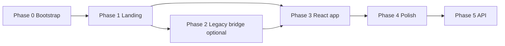

# NakuruHub → Next.js Migration Plan

> **For agentic workers:** Use `superpowers:subagent-driven-development` or `superpowers:executing-plans` task-by-task. Track work with checkbox (`- [ ]`) items below.

**Goal:** Move the NakuruHub static prototype (`C:\Users\mhki\nakuruhub\nakuruhub`) into the Next.js app (`C:\Users\mhki\hub`) with matching visuals, behavior, and routes—without rewriting the Flamingo Lake design system on day one.

**Architecture:** App Router with two surfaces: marketing at `/` and the interactive demo at `/app`. Keep existing CSS as global styles (not Tailwind-first). Port `landing.html` inline scripts to focused React client hooks/components. Refactor `js/app.js` from string templates + `innerHTML` into a single client shell with typed data modules and tab/view components. Defer API integration until UI parity; optionally proxy to `nakuruhub/server` in a later phase.

**Tech stack:** Next.js 16.4.6, React 19, TypeScript, existing `css/styles.css` (+ `landing.css`), Playwright visual QA (ported from `_qa-pass7.mjs`).

## Global constraints

- Target repo: `C:\Users\mhki\hub` (pnpm).
- Source of truth for UI until parity: `C:\Users\mhki\nakuruhub\nakuruhub`.
- Preserve EN/SW copy via `data-en` / `data-sw` pattern (or equivalent JSON i18n)—no dropped strings.
- Fonts: `Bricolage Grotesque` + `Figtree` (self-hosted woff2; copy or fetch into `public/fonts/`).
- Routes: `/` = landing, `/app` = customer demo, `/app?start=vendor` = vendor signup entry (preserve query contract).
- Do not remove prototype repo until Next passes QA and stakeholder sign-off.
- Read Next.js 16 docs under `node_modules/next/dist/docs/` before changing routing, metadata, or font APIs.
- No secrets in git; `server/.env` stays separate.

---

## Target file layout (`hub`)

| Path | Responsibility |
|------|----------------|
| `app/layout.tsx` | Root metadata, font loading, import `nakuru-globals.css` |
| `app/nakuru-globals.css` | Imports copied `styles.css` + `landing.css` (paths fixed for `/public`) |
| `app/page.tsx` | Marketing landing (server shell + client islands) |
| `app/app/layout.tsx` | Optional: `body` class for app chrome only |
| `app/app/page.tsx` | Client-only marketplace shell |
| `components/landing/*` | Header, hero, sections, footer, mobile CTA bar |
| `components/landing/hooks/*` | `useLandingLang`, `useRevealSections`, `useMobileCtaBar`, `useCheckoutDemo`, `useDashboardTabs` |
| `lib/nakuru/i18n.ts` | `applyLang(lang)`, localStorage key `nakuruhub-landing-lang` |
| `lib/nakuru/data/*` | `items.ts`, `zones.ts`, `categories.ts` (extracted from `app.js` CONFIG) |
| `lib/nakuru/types.ts` | `AppState`, `Listing`, `Order`, `VendorApp` |
| `components/app/*` | `AppHeader`, `BottomNav`, `Toast`, views: `HomeView`, `CategoryView`, etc. |
| `public/fonts/*.woff2` | Self-hosted fonts |
| `public/assets/*` | `icon.svg`, manifest assets |
| `e2e/landing.spec.mjs` | Playwright parity vs prototype |
| `e2e/app-smoke.spec.mjs` | Tab navigation, cart add, vendor query param |

**Remove or replace** default Create Next App homepage (`app/page.tsx` Tailwind demo) in Phase 1.

---

## Phase 0 — Workspace bootstrap (≈1–2 hours)

### Task 0.1: Copy static assets into `hub`

**Files:**
- Create: `public/fonts/bricolage-grotesque-latin.woff2`, `public/fonts/figtree-latin.woff2` (from prototype if present; otherwise download licensed woff2 and commit)
- Copy: `assets/icon.svg` → `public/`
- Copy: `manifest.webmanifest`, `robots.txt`, `sitemap.xml` → `public/` (update URLs to production domain later)

- [x] Copy font files and fix 404s in devtools Network tab
- [x] Run `pnpm dev` and confirm fonts load from `/fonts/...`

### Task 0.2: Global CSS wiring

**Files:**
- Create: `app/nakuru-globals.css` — `@import` or paste with `url(../fonts/...)` changed to `url(/fonts/...)`
- Modify: `app/layout.tsx` — remove Geist/Tailwind marketing defaults from body; set `lang="en"`, metadata from `landing.html` lines 6–10
- Modify: `app/globals.css` — either delete Tailwind demo tokens or keep Tailwind only for dev scaffolding (NakuruHub CSS wins for product pages)

- [x] Landing route shows correct theme colors (`#0d5c58` theme-color)
- [x] `pnpm build` succeeds

### Task 0.3: Route map

| Old | New |
|-----|-----|
| `landing.html` | `/` |
| `index.html` | `/app` |
| `index.html?start=vendor` | `/app?start=vendor` |

- [x] Add redirects in `next.config.ts` if you later host legacy paths (`/landing.html` → `/`)

**Checkpoint:** Blank Next starter gone; CSS + fonts work on an empty `/` placeholder.

---

## Phase 1 — Marketing landing (≈1–2 days)

Split `landing.html` (~900 lines) into components; keep class names identical to avoid CSS churn.

### Task 1.1: Landing shell

**Files:**
- Create: `components/landing/LandingPage.tsx` (client wrapper for lang + scripts)
- Create: `components/landing/LandingHeader.tsx`, `LandingFooter.tsx`
- Modify: `app/page.tsx` — render `<LandingPage />`

**Interfaces:**
- Produces: `useLandingLang(): { lang: 'en' \| 'sw'; setLang; t(attrs) }`

Port script block starting ~line 579: `apply`, `setMenu`, scroll-spy for `#categories`, `#why`, `#how`, `#faq`.

- [ ] Mobile nav open/close + Escape
- [ ] EN/SW toggle persists in `localStorage`
- [ ] In-page nav highlights on scroll

### Task 1.2: Section components

**Files:**
- Create: `components/landing/sections/HeroSection.tsx`
- Create: `.../CategoriesSection.tsx`, `WhySection.tsx`, `DashboardSection.tsx`, `HowSection.tsx`, `FaqSection.tsx`, `CtaBandSection.tsx`
- Modify: All `href="index.html"` → `<Link href="/app">` or `/app?start=vendor`

- [ ] No horizontal overflow at 360px, 390px, 768px, 1024px, 1440px (match `_qa-pass7.mjs` widths)

### Task 1.3: Interactive landing demos

Port inline IIFEs from `landing.html`:

| Feature | Hook / component |
|---------|------------------|
| `.reveal-section` + IntersectionObserver | `useRevealSections()` |
| `#mobile-cta-bar` | `useMobileCtaBar()` |
| Checkout phone demo (`initCheckoutDemo`) | `useCheckoutDemo()` |
| Dashboard tabs (`initDashboardDemo` or equivalent) | `useDashboardTabs()` |

- [ ] Checkout verified/unverified tabs + auto-cycle respects `prefers-reduced-motion`
- [ ] Dashboard tab panels: correct `aria-selected` / `hidden`

### Task 1.4: Landing SEO & a11y

**Files:**
- Modify: `app/layout.tsx` or `app/page.tsx` `metadata` — title, description, OG tags from `landing.html`
- Add: skip link, `proto-banner`, semantic landmarks

- [ ] View page source shows metadata
- [ ] Run ported Playwright: `e2e/landing.spec.mjs` against `http://localhost:3000/`

**Checkpoint:** `/` visually and behaviorally matches `landing.html` file-open baseline.

---

## Phase 2 — App shell bridge (optional fast path, ≈2–4 hours)

*Skip this phase if you commit to full React port in Phase 3.*

### Task 2.1: Thin client wrapper

**Files:**
- Create: `app/app/page.tsx` with `'use client'`
- Create: `components/app/LegacyAppMount.tsx` — mounts DOM ids `#hd`, `#v`, `#nav`, `#sb`, `#fab`, `#pf`, `#toast`
- Load logic via dynamic import of a copied `public/legacy/app.js` OR `lib/nakuru/legacy/app.js` (unchanged initially)

- [x] `/app` renders and `render()` runs
- [x] `?start=vendor` opens vendor flow (line 146 in `app.js`)

**Risk:** `innerHTML` + Next hydration — use `useEffect` mount only, no SSR for app route.

**Checkpoint:** Demo works in Next quickly; tech debt acknowledged.

---

## Phase 3 — React port of `app.js` (≈2–4 days)

`app.js` is ~148 lines but dense: 6 sections (CONFIG, STATE, HELPERS, VIEWS, RENDER, EVENTS).

### Task 3.1: Extract data layer (no UI)

**Files:**
- Create: `lib/nakuru/data/items.ts`, `zones.ts`, `constants.ts`
- Create: `lib/nakuru/types.ts`
- Create: `lib/nakuru/format.ts` — `kes(n)`, `esc(s)` → prefer React text escaping; keep `esc` only if any residual HTML strings

- [ ] Unit-test `kes` formatting (`en-KE` locale) in `lib/nakuru/format.test.ts` (add Vitest or Node test script)

### Task 3.2: App state store

**Files:**
- Create: `components/app/AppProvider.tsx` — `useReducer` mirroring object `S` in `app.js`
- Create: `lib/nakuru/reducer.ts` — actions: `SET_TAB`, `SET_CAT`, `CART_INC`, `PLACE_ORDER`, etc.

**Interfaces:**
- Produces: `useNakuruApp(): { state, dispatch, toast }`

- [ ] Deep link: on mount, read `searchParams` for `start=vendor` → `{ tab: 'acc', acc: 'vendor' }`

### Task 3.3: Chrome components

**Files:**
- Create: `components/app/AppHeader.tsx` (area select, search, category tabs)
- Create: `components/app/BottomNav.tsx`, `SignInBar.tsx`, `Fab.tsx`, `Toast.tsx`

Map `chrome()` from `app.js` lines 100–106.

- [ ] Cart badge count on nav
- [ ] Outside-Nakuru area blocks checkout messaging

### Task 3.4: Views (one PR-sized chunk each)

| `app.js` function | React component |
|-------------------|-----------------|
| `home()` | `HomeView.tsx` |
| `catv()` | `CategoryView.tsx` |
| `msgv()` | `MessagesView.tsx` |
| `cartView()` | `CartView.tsx` |
| `acc()` / `vendor()` / `admin()` | `AccountView.tsx`, `VendorView.tsx`, `AdminView.tsx` |

Replace `data-a` delegated clicks with explicit `onClick` handlers calling `dispatch`.

- [ ] Home carousel: scroll sync + interval (respect reduced motion)
- [ ] Cart: COD vs M-Pesa rules for unverified vendors
- [ ] Vendor registration validation (phone regex, categories)
- [ ] Admin approve / verified badge (demo)

### Task 3.5: Profile photo upload

Port `#pf` change handler (canvas resize, 5MB limit) to `VendorView` / `AccountView`.

- [ ] JPEG/PNG/WebP only; error toasts match prototype copy

### Task 3.6: Remove legacy script

- [ ] Delete `LegacyAppMount` / `legacy/app.js` if Phase 2 was used
- [ ] `e2e/app-smoke.spec.mjs`: add to cart → place order → see order card

**Checkpoint:** `/app` fully React; no `innerHTML` for main views.

---

## Phase 4 — Polish, PWA, deploy (≈1 day)

### Task 4.1: Metadata & icons

- Wire `manifest.webmanifest`, favicon (inline flamingo or `icon.svg`)
- `app/layout.tsx` `viewport`, `themeColor`

### Task 4.2: Performance

- `next/font/local` for woff2 OR keep CSS `@font-face` (pick one; avoid double-loading)
- Lazy-load below-fold landing sections if LCP regresses

### Task 4.3: CI

**Files:**
- Create: `.github/workflows/e2e.yml` — `pnpm build`, `pnpm start`, Playwright landing + app smoke

*(Skipped per stakeholder — run Playwright locally per README.)*

### Task 4.4: Documentation

- Update root `README.md`: `pnpm dev`, route map, link to prototype repo for history

**Checkpoint:** Production build on Vercel/similar; QA scripts green.

---

## Phase 5 — Backend integration (future, separate plan)

Do not block UI migration on this.

| Concern | Direction |
|---------|-----------|
| Auth, OTP, M-Pesa | `nakuruhub/server` Express API |
| Next integration | `app/api/[...]` proxy OR move API into Route Handlers gradually |
| Data | Replace `ITEMS` array with `fetch('/api/catalog')` |
| Realtime | WebSocket from `server/src/realtime.js` → client hook |

Spike task: `NEXT_PUBLIC_API_URL` + CORS on Express — one read-only catalog endpoint.

---

## Recommended execution order

**Default:** Phase 0 → 1 → 3 (skip 2 unless you need `/app` demo within 24h).

---

## Verification matrix

| Check | Command / action |
|-------|----------------|
| Dev server | `cd C:\Users\mhki\hub && pnpm dev` |
| Production build | `pnpm build && pnpm start` |
| Landing parity | Playwright `e2e/landing.spec.mjs` (port from `_qa-pass7.mjs`, base URL `http://localhost:3000`) |
| App smoke | Manual or `e2e/app-smoke.spec.mjs` |
| i18n | Toggle EN/SW on landing + reload |
| Vendor entry | Open `/app?start=vendor` |
| a11y spot-check | Keyboard: landing menu, checkout tabs, dashboard tabs |

---

## Risk register

| Risk | Mitigation |
|------|------------|
| Missing `fonts/` in prototype repo | Download woff2 before Phase 0 sign-off |
| CSS path breakage | Single `nakuru-globals.css` with `/fonts` absolute paths |
| Hydration mismatch on app | `app/app/page.tsx` client-only; `export const dynamic = 'force-static'` only if no SSR DOM |
| Scope creep (Tailwind rewrite) | Freeze: use existing CSS until Phase 5+ |
| Duplicating monorepo | Long-term: move `nakuruhub` into `hub` package or git submodule; short-term copy is fine |

---

## Suggested commits (frequent, small)

1. `chore: add nakuru fonts and global css`
2. `feat: marketing landing shell and i18n`
3. `feat: landing sections and interactive demos`
4. `test: playwright landing parity`
5. `feat: app route with react state and chrome`
6. `feat: cart and vendor flows`
7. `feat: admin demo panel`
8. `chore: manifest, readme, e2e ci`

---

## Spec coverage self-check

- Landing HTML/CSS → Phase 1 tasks 1.1–1.4
- `app.js` behavior → Phase 3 tasks 3.1–3.5
- `?start=vendor` → Phase 3.2
- Server API → Phase 5 (explicitly deferred)
- EN/SW → Phase 1.1 + reuse `lib/nakuru/i18n.ts` for shared strings later
- Playwright QA → Phase 1.4 + 4.3