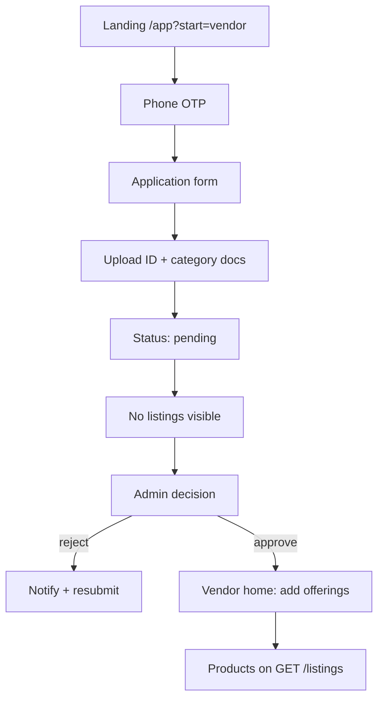
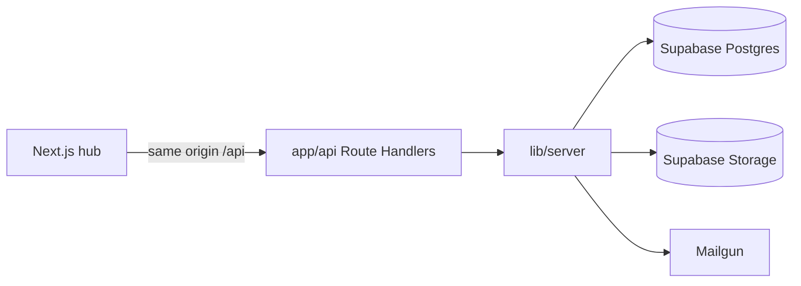

# Vendor onboarding & marketplace launch — design spec

**Status:** Approved for implementation (infra locked)  
**Date:** 2026-11-15  
**Repo (implementation):** `C:\Users\mhki\hub` only — Next.js UI + `app/api` + `lib/server`.  
**Reference (read-only):** `C:\Users\mhki\nakuruhub\nakuruhub\server` — port logic, do not implement there.  
**Related:** [Next.js migration plan](../plans/2026-11-15-nakuruhub-nextjs-migration.md) Phase 5  
**Implementation plan:** [vendor-onboarding-launch plan](../plans/2026-11-15-vendor-onboarding-launch.md)

### Infrastructure (locked)

| Layer | Choice |
|-------|--------|
| Database | **Supabase** (managed PostgreSQL; migrations via SQL in repo) |
| Vendor documents (launch) | **Deferred** — onboarding identity = **email OTP** only; Storage + `vendor_documents` APIs post-launch (Phase P1) |
| Customer/vendor OTP | **Email** via **Mailgun** (replaces Africa's Talking SMS for auth) |
| Staff auth | Email + password + TOTP (unchanged model; identifier migrates from phone to email) |
| Delivery contact | Optional `users.phone` collected at checkout, not used for OTP |

---

## 1. Summary

NakuruHub will **publicly launch** a multi-vendor marketplace for **Nakuru County** with a **strict trust model**: nothing from a vendor is visible to buyers until **staff approve** the vendor application. **At launch**, applicant identity is **email OTP** (Mailgun); staff review application fields—not in-app ID uploads (document storage is **Phase P1 deferred**). **Verified** (stronger KYC for payments) remains a **separate admin step** that unlocks **M-Pesa upfront**; unverified approved vendors sell via **cash on delivery** only.

**Launch categories:** **Shop** (cart + delivery checkout) and **Services** (catalog + quote requests). Property, cars, stays, and taxi remain waitlisted in UI and are not accepted in vendor applications at launch.

**Pre-launch ops:** Recruit and pre-approve **10–15 anchor vendors** (documents collected offline) so the public catalog is not empty on day one.

---

## 2. Goals and success criteria

### Goals

1. Real vendors can apply, pass admin review, and publish **shop products** and **service listings** that appear on the public marketplace.
2. Customers browse a **live catalog** backed by PostgreSQL, not the static `ITEMS` demo array.
3. Shop checkout uses the existing **order pipeline** (COD at launch for unverified vendors).
4. Services use a dedicated **quote / inquiry** flow (not the shop cart).
5. Admin can review applications (queue + approve / reject / verify); **document URLs** come in Phase P1 if product requires in-app KYC.

### Success criteria (launch gate)

| Criterion | Measure |
|-----------|---------|
| No public listings while `pending` | `GET /listings` returns only `approved` vendors’ active products |
| Applicant identity | Vendor apply requires completed **email OTP** session; admin sees verified email on queue |
| Documents not public | **Launch:** N/A (no uploads). **Post P1:** ID/category files only via short-lived signed URLs |
| Shop path E2E | OTP → apply → approve → add product → customer COD order → vendor sees order |
| Services path E2E | OTP → apply (services) → approve → add service → customer submits inquiry → vendor notified |
| Anchor inventory | ≥10 approved vendors with ≥1 live listing before marketing push |
| Admin SLA (ops) | Documented target: review within **24–48 hours** of application |

### Non-goals (launch v1)

- Property, cars, stays, taxi vendor onboarding and checkout.
- Customer M-Pesa checkout (optional post-launch for **verified** vendors only).
- Full vendor dashboard (stock analytics, earnings, messaging threads).
- Automated KYC / third-party identity providers.
- Rider assignment and realtime map (existing server code may stay idle).

---

## 3. Decisions (locked from product discussion)

| Topic | Decision |
|-------|----------|
| Launch posture | Public launch, not pilot-only demo data |
| Visibility gate | Listings public **only after admin approve** |
| ID / documents (launch) | **Email OTP only** at apply; no Storage. Offline/anchor KYC optional; in-app docs = Phase P1 |
| ID / documents (post P1) | Collected at apply; reviewed as part of **approval** (not a separate gate for first listing) |
| Verified badge | Post-approval admin action; enables M-Pesa upfront when implemented |
| Categories at launch | `shop`, `services` only |
| Services checkout | **Inquiries / quote requests**, not `POST /orders` (orders are shop-only today) |
| Anchor strategy | Pre-vetted vendors seeded before broad marketing |

---

## 4. Current system vs gaps

### Already implemented (API)

- Phone OTP auth, JWT access + refresh (`server/src/auth.js`).
- `POST /vendors` → `pending`; admin approve / reject / verify (`server/src/vendors.js`).
- `POST /products`, `GET /listings`, vendor product management (`server/src/catalog.js`).
- Shop orders (`POST /orders` filters `p.category = 'shop'`).
- Audit log for sensitive actions.
- Zod validation (`server/src/schemas.js`), role middleware.

### Already implemented (Next.js demo)

- Vendor signup UX, admin approve demo, COD vs M-Pesa rules in UI.
- Static catalog (`lib/nakuru/data/items.ts`).
- **No persistence**, **no** add-product UI, **no** API calls.

### Gaps to build

1. ~~**Document upload & storage**~~ → **deferred (P1)**; launch uses OTP + admin queue only.
2. **Next.js ↔ API** integration (auth cookies/headers, `NEXT_PUBLIC_API_URL`).
3. **Vendor listing management UI** (add/edit shop product, add/edit service listing).
4. **Catalog reads** from `GET /listings` (+ category filters).
5. **Service inquiries** API + customer UI + vendor notification.
6. **Staff admin UI** in Next for vendor queue (documents UI when P1 lands).
7. Production **SMS OTP**, secrets, TLS, and items from `security/SECURITY.md` checklist.

---

## 5. User journeys

### 5.1 Vendor (self-serve)

**Application fields (v1):**

- Business / vendor name (2–60 chars, matches `vendorNew.name`).
- Categories: non-empty subset of `{ shop, services }` (max 4 in schema; launch UI only offers these two).
- Profile image / logo (optional at apply, max 5MB, image types as demo).
- **Required:** national ID image (front; back optional v1).
- **Required when `services` selected:** at least one proof-of-trade document (e.g. certification, business permit, or portfolio photo)—exact label copy TBD in UI, stored as typed `category_doc`.

**After approve:**

- Add **shop product:** title, description, emoji, price (KES), stock (optional; default unlimited behavior only for non-shop in schema—shop uses stock field).
- Add **service listing:** title, description, emoji, **from price** (KES; may be 0 for “price on request” if product policy allows—default minimum 0 in `money` schema).
- Edit / deactivate own products via existing update endpoint.

**While `pending`:**

- Vendor may log in and see application status only; **no** `POST /products` (server already returns `no_approved_vendor`).

### 5.2 Customer

**Shop:**

- Browse/search listings (shop category).
- Add to cart → checkout: zone, address, **COD** (M-Pesa option hidden or disabled unless all cart vendors verified and M-Pesa enabled).

**Services:**

- Browse service listings.
- **Request quote:** short form (optional message, max 500 chars); must be logged in (phone on file).
- Confirmation UI; vendor receives inquiry (in-app list v1 minimum; SMS optional stretch).

### 5.3 Admin / support

- Staff login: existing `/auth/staff/login` (password + TOTP)—not SMS OTP.
- **Vendor queue:** filter `pending`, open application, view documents (signed URLs), approve or reject with optional internal note (stored in audit `meta` only v1).
- **Verify** action: separate from approve; sets `verified=true` for M-Pesa eligibility.
- Optional: pre-seed anchor vendors via DB/script + manual document archival until self-serve upload exists for staff-created rows.

---

## 6. Architecture

### 6.1 Runtime topology

**Integration pattern (launch):**

- Browser calls **relative** `/api/...` with `credentials: 'include'` for refresh cookie on `/api/auth/*`.
- Access token: in-memory on client; `Authorization: Bearer` on API calls.
- Route Handlers delegate to `lib/server/*` (ported from reference Express handlers).
- **No separate API process** and no CORS for production same-origin deploy.

**Do not** implement or deploy the prototype `nakuruhub/server` for launch.

### 6.2 Document storage

**Requirements (from `security/SECURITY.md`):**

- Vendor ID and category documents **never** on public URLs or CDN.
- Least privilege; encryption at rest on bucket; TLS in transit.

**v1 approach:**

- Store blobs in **private S3-compatible bucket** (or local encrypted volume in staging only).
- DB holds metadata only: `vendor_documents` table (see §7).
- Upload flow: authenticated vendor → `POST /vendors/me/documents` with **multipart** or **presigned PUT** (prefer presigned for large files and to keep JSON body limit 10kb).
- Download: `GET /admin/vendors/:id/documents/:docId/url` and `GET /vendors/me/documents/:docId/url` return **signed URL**, TTL ≤ 15 minutes, logged in audit.

**File limits:**

- Max 5 MB per file; MIME allowlist: `image/jpeg`, `image/png`, `image/webp`, `application/pdf`.
- Max 10 files per vendor application (v1).

### 6.3 Service inquiries (new subsystem)

**Rationale:** `POST /orders` only includes `category = 'shop'`. Services need a parallel, lightweight lead model.

**Behavior:**

- Customer `POST /service-inquiries` with `{ productId, message? }`.
- Server validates: product active, category `services`, vendor approved, customer ≠ owner.
- Row inserted; vendor `owner_id` can `GET /service-inquiries` (mine as vendor) or `GET /vendor/inquiries`.
- Admin read-only list optional v1.
- Notification v1: **poll on vendor dashboard**; stretch goal SMS to vendor phone using existing `sms.js`.

---

## 7. Data model changes

New migration file: `server/db/migrations/003_vendor_docs_and_inquiries.sql`

### 7.1 `vendor_documents`

| Column | Type | Notes |
|--------|------|--------|
| `id` | uuid PK | |
| `vendor_id` | uuid FK → vendors | |
| `kind` | text | `national_id_front`, `national_id_back`, `category_doc`, `logo` |
| `storage_key` | text | Opaque path in bucket |
| `mime` | text | |
| `size_bytes` | int | |
| `created_at` | timestamptz | |

Indexes: `(vendor_id)`, enforce at application submit that required kinds exist (app logic).

### 7.2 `service_inquiries`

| Column | Type | Notes |
|--------|------|--------|
| `id` | uuid PK | |
| `product_id` | uuid FK → products | |
| `customer_id` | uuid FK → users | |
| `message` | text | default `''`, max 500 |
| `status` | text | `open`, `closed` (v1) |
| `created_at` | timestamptz | |

Indexes: `(product_id)`, `(customer_id)`, vendor lookup via join.

### 7.3 `vendors` (optional columns)

If reject reasons should be visible to vendor (v1 minimal: **no**; only audit meta). Optional later: `rejection_reason text`.

### 7.4 Grants

Extend `nakuruhub_app` role grants for new tables (same pattern as `schema.sql`).

---

## 8. API surface (new and changed)

### 8.1 Documents (new router or extend `vendors.js`)

| Method | Path | Auth | Description |
|--------|------|------|-------------|
| POST | `/vendors/me/documents/presign` | vendor/customer applying | Returns presigned PUT URL + `documentId` |
| POST | `/vendors/me/documents/complete` | same | Confirm upload, validate size/MIME via HEAD |
| GET | `/vendors/me/documents` | owner | List metadata (no direct URLs) |
| GET | `/vendors/me/documents/:id/url` | owner | Signed download |
| GET | `/admin/vendors/:vendorId/documents` | admin | List for review |
| GET | `/admin/vendors/:vendorId/documents/:id/url` | admin | Signed download |

**Apply gate:** `POST /vendors` may require `national_id_front` document present when enforcement flag enabled (config).

### 8.2 Vendors (existing, behavior notes)

- `POST /vendors`: categories restricted at validation layer for launch to `shop` | `services` only (config or schema refine).
- `GET /admin/vendors?status=pending`: include `created_at`, categories; documents count.

### 8.3 Service inquiries (new)

| Method | Path | Auth | Description |
|--------|------|------|-------------|
| POST | `/service-inquiries` | customer | Create inquiry |
| GET | `/service-inquiries/mine` | customer | Customer’s inquiries |
| GET | `/vendor/inquiries` | vendor | Inquiries for my products |
| POST | `/vendor/inquiries/:id/close` | vendor | Mark closed (optional v1) |

Schemas in `schemas.js`: `inquiryNew`, `uuid` paths.

### 8.4 Catalog (unchanged paths, launch rules)

- Public `GET /listings?category=shop|services`.
- Vendor must have category in `vendors.categories` to post (`category_not_approved`).

---

## 9. Frontend (Next.js `hub`)

### 9.1 Routes and entry points

| Route | Purpose |
|-------|---------|
| `/app?start=vendor` | Deep link preserved; opens vendor flow after OTP |
| `/app` | Customer browse; catalog from API |
| `/app/...` | Account tab hosts vendor UX when role/vendor approved |

**Staff admin:** protected route e.g. `/staff` or `/app?start=admin` **only** after staff login—not the demo “Admin panel” without auth.

### 9.2 State management migration

- Replace `createInitialState` demo vendor registration with API-backed vendor profile (`GET /vendors/mine`).
- Keep reducer for UI-only concerns (tab, cart) initially; progressively move cart persistence to server orders post-launch if needed.
- `ITEMS` fallback: remove for production build behind `USE_LIVE_CATALOG=true` env.

### 9.3 UI components (new or extended)

| Component | Work |
|-----------|------|
| `VendorView` | Wire apply + document upload steps; show real status |
| `VendorProductForm` | Shop + service modes |
| `ServiceInquirySheet` | Request quote from product detail |
| `StaffVendorQueue` | Pending list, doc viewer links, approve/reject/verify |
| `HomeView` / `CategoryView` | Fetch listings; service CTA vs shop add-to-cart |

### 9.4 Copy and i18n

- Preserve EN/SW for new strings (`data-en` / `data-sw` or shared i18n module).
- Clarify: services = **quote request**, not immediate payment.

---

## 10. Security, privacy, and compliance

- **Kenya DPA 2019:** Privacy notice and consent before ID upload; purpose limitation (verification and dispute resolution); retention policy documented (e.g. delete rejected applicant docs after 90 days unless legal hold).
- **No enumeration:** OTP request stays generic 202.
- **Staff never via SMS OTP** (existing rule).
- **Launch checklist:** Complete applicable items in `security/SECURITY.md` before real PII and money (SMS, backups, pentest, security.txt, etc.).
- **Rate limits:** Document presign and inquiry endpoints get per-user limits similar to orders.

---

## 11. Anchor vendor seeding (operations)

**Before public marketing:**

1. Collect phone, business name, categories, documents offline (with consent form).
2. Staff ensures user exists (vendor completes OTP once or staff uses documented script).
3. Staff creates/approves vendor record; uploads documents via same API or secure internal tool.
4. Staff or vendor adds initial products.
5. Verify `GET /listings` shows expected SKUs.

**Target:** 10–15 vendors, ≥1 listing each, mix of shop and services.

---

## 12. Phased delivery plan

| Phase | Scope | Outcome |
|-------|--------|---------|
| **P0** | API deploy, DB migrate, SMS OTP staging | Authenticated clients |
| **P1** | Document storage + apply with uploads + admin review URLs | **Deferred post-launch** (OTP-only trust gate for v1) |
| **P2** | Next: OTP, vendor apply, staff queue | Self-serve pending apps |
| **P3** | Next: add product/service + live catalog | Buyers see real data |
| **P4** | Shop checkout wired to API orders | Revenue path COD |
| **P5** | Service inquiries + vendor inbox | Services launch complete |
| **P6** | Anchor seeding + production hardening | Public launch |

Dependencies: P2 blocks P3; P3 blocks P4/P5; P6 follows P4 minimum for shop-heavy anchors.

**Migration plan relationship:** This spec **supersedes** the open-ended “Phase 5 — Backend integration” table for scope definition; implementation plan should reference concrete tasks from §8–9.

---

## 13. Testing and verification

| Area | Tests |
|------|--------|
| API | Integration tests: apply without docs fails when enforced; approved vendor can post; pending cannot; listings exclude pending |
| Security | Document URLs expire; other user cannot fetch foreign doc |
| E2E Playwright | Extend `e2e/app-smoke.spec.mjs`: vendor deep link, catalog load mock or staging API |
| Manual | Full shop E2E and service inquiry on staging with test SMS |

---

## 14. Risks and mitigations

| Risk | Mitigation |
|------|------------|
| Admin queue backlog | Anchor pre-approval; SLA; notify admin on new application (email/webhook stretch) |
| SMS cost / failure | Daily caps exist; monitor; fallback support channel for anchors |
| Empty catalog at launch | Anchor seeding gate in §11 |
| Scope creep (property/cars) | Waitlist UI; server reject categories outside shop/services at launch |
| Cookie/CORS friction | Early spike `NEXT_PUBLIC_API_URL` + refresh from Next origin |

---

## 15. Open questions (minor — resolve during implementation plan)

1. **Reject feedback:** Show reason to vendor in app v1, or only “rejected, contact support”?
2. **Service “from price” 0:** Allow `price_kes = 0` for “Contact for quote” display?
3. **Vendor SMS on new inquiry:** Required for launch or phase P5.1?
4. **Hosting:** Same VPS as API + managed Postgres vs split (affects presigned URL domain).

---

## 16. Approval

| Role | Name | Date | Approved |
|------|------|------|----------|
| Product / owner | | | ☐ |
| Engineering | | | ☐ |

---

*After approval: invoke `writing-plans` skill to produce `docs/superpowers/plans/2026-11-15-vendor-onboarding-launch.md` with checkbox tasks.*